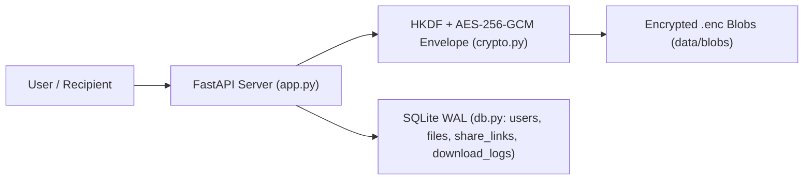

# VaultDrop

Encrypted self-hosted file sharing and transfer platform built with FastAPI, SQLite, and Python's `cryptography` library.

## Purpose & Problem Statement

Sharing sensitive artifacts or build drops over unencrypted links or external cloud drives exposes plaintext payloads, lacks download limits, and leaves no audit trail. VaultDrop encrypts every file at rest using envelope AES-256-GCM cryptography via Python's audited `cryptography` library, enforces storage quotas and SHA-256 integrity verification, and issues expiring, passcode-protected, revocable share tokens.

## Features

- **Envelope AES-256-GCM Encryption**: Every uploaded file is encrypted with a freshly generated 256-bit DEK wrapped by a per-file KEK derived from the server master key via HKDF-SHA256.
- **Integrity Verification**: Verifies both AES-GCM authentication tags (with `file_id` AAD) and plaintext SHA-256 digests on every download.
- **Expiring & Revocable Share Links**: Configurable TTL (`ttl_minutes`), optional download caps (`max_downloads`), optional scrypt-hashed passcodes, and instant revocation.
- **Quotas & Role-Based Access**: Scrypt password hashing, JWT authentication, per-user byte quotas, and automatic `admin` role assignment for the first registered user.
- **Audit Logging & Admin Panel**: Records authenticated and shared downloads (file ID, token/actor, client IP, timestamp) and exposes quota/log management in the web UI.

## Tech Stack

- **Backend**: Python 3.11+, FastAPI, Uvicorn, aiosqlite, Pydantic v2, PyJWT
- **Cryptography**: `cryptography` (`AESGCM`, `HKDF`), `hashlib.scrypt`, `hashlib.sha256`
- **Frontend**: Vanilla HTML/CSS/JS

## System Requirements

- Python 3.11 or newer

## Installation

```bash
git clone https://github.com/fully-ai/vaultdrop.git
cd vaultdrop
python3 -m venv .venv
source .venv/bin/activate
pip install -e ".[dev]"
```

## Configuration

| Variable | Default | Description |
| --- | --- | --- |
| `VAULTDROP_HOST` | `127.0.0.1` | Bind address |
| `VAULTDROP_PORT` | `8090` | HTTP port |
| `VAULTDROP_DATA_DIR` | `./data` | Database, key files, and encrypted blob directory |
| `VAULTDROP_MAX_FILE_BYTES` | `26214400` | Max single upload size (25 MiB) |
| `VAULTDROP_DEFAULT_QUOTA_BYTES` | `104857600` | Default per-user quota (100 MiB) |
| `VAULTDROP_MASTER_KEY_HEX` | auto-generated `0600` key file | 64-hex-char (32-byte) master key |
| `VAULTDROP_JWT_SECRET` | auto-generated `0600` key file | HMAC-SHA256 JWT signing secret |

## Running & Usage Examples

```bash
vaultdrop
```

API usage:

```bash
# Register first user (admin)
curl -s -X POST http://127.0.0.1:8090/api/auth/register \
  -H 'Content-Type: application/json' \
  -d '{"username":"admin","password":"strongpassword"}'

# Upload & encrypt file
curl -s -X POST http://127.0.0.1:8090/api/files \
  -H "Authorization: Bearer <TOKEN>" \
  -F "file=@archive.tar.gz"

# Create expiring share token (60m TTL, max 2 downloads)
curl -s -X POST http://127.0.0.1:8090/api/files/<FILE_ID>/share \
  -H "Authorization: Bearer <TOKEN>" \
  -H 'Content-Type: application/json' \
  -d '{"ttl_minutes":60,"max_downloads":2,"passcode":"secret12"}'
```

## API Documentation

| Method & Path | Auth | Description |
| --- | --- | --- |
| `GET /api/health` | Public | Service health status |
| `POST /api/auth/register` / `POST /api/auth/login` | Public | Register or authenticate and receive JWT |
| `GET /api/auth/me` | Bearer | Current user profile and quota usage |
| `POST /api/files` / `GET /api/files` | Bearer | Upload/encrypt or list user's encrypted files |
| `GET /api/files/{id}/download` / `DELETE /api/files/{id}` | Owner/Admin | Decrypt/download or delete blob and reclaim quota |
| `POST /api/files/{id}/share` | Owner | Create expiring/passcode/capped share link |
| `POST /api/share/{token}/revoke` | Owner | Immediately revoke an active share link |
| `POST /api/share/{token}/download` | Public/Passcode | Download shared file if valid and unrevoked |
| `GET /api/admin/users` / `PATCH /api/admin/users/{id}/quota` | Admin | Manage user storage quotas |
| `GET /api/admin/logs` | Admin | View download audit trail |

## Architecture



## File Structure

```
vaultdrop/
├── src/vaultdrop/
│   ├── app.py            # FastAPI routes, quota checks, share enforcement
│   ├── config.py         # Settings & 0600 key generation
│   ├── crypto.py         # HKDF-SHA256, AES-256-GCM, scrypt, SHA-256 checks
│   ├── db.py             # Async SQLite repository
│   ├── main.py           # CLI entrypoint
│   └── static/index.html # Web vault + admin UI
├── tests/test_vaultdrop.py
├── docs/architecture.md
├── Dockerfile
└── compose.yaml
```

## Testing

```bash
ruff check src tests
mypy src
pytest -v
```

## Docker Deployment

```bash
docker compose up -d --build
```

## Security Notes

- Master keys and JWT secrets generated on first boot are written with `0o600` file permissions; set `VAULTDROP_MASTER_KEY_HEX` and `VAULTDROP_JWT_SECRET` explicitly via environment secrets in production.
- Place behind HTTPS/TLS in production so bearer tokens and share passcodes are encrypted in transit.

## Known Limitations

- Encryption occurs server-side at rest (master key resides on the host); end-to-end zero-knowledge browser encryption is not implemented.

## Contributing

See [CONTRIBUTING.md](CONTRIBUTING.md) and [CODE_OF_CONDUCT.md](CODE_OF_CONDUCT.md).

## License

Apache License 2.0 — see [LICENSE](LICENSE).
